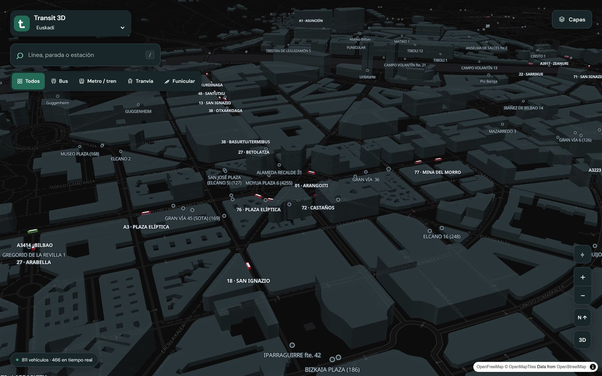
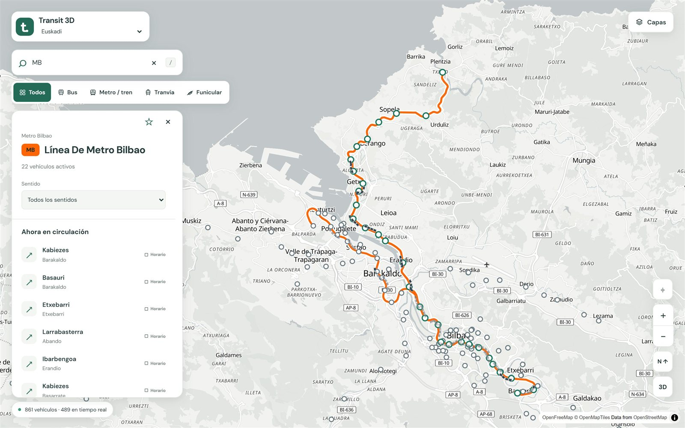
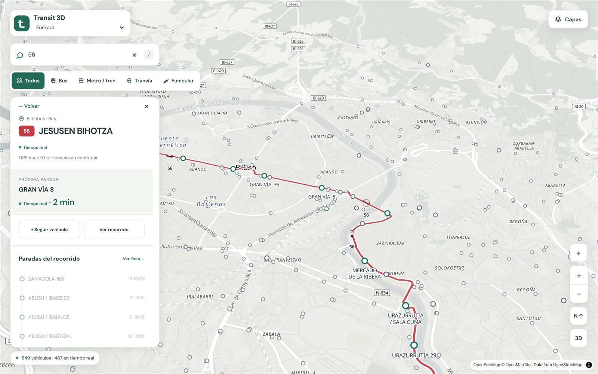
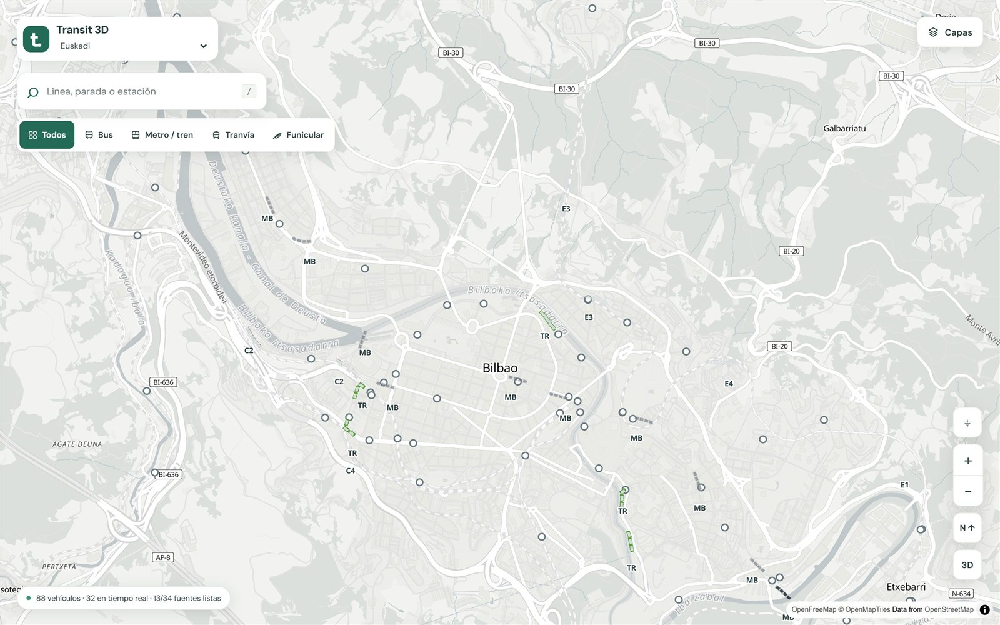
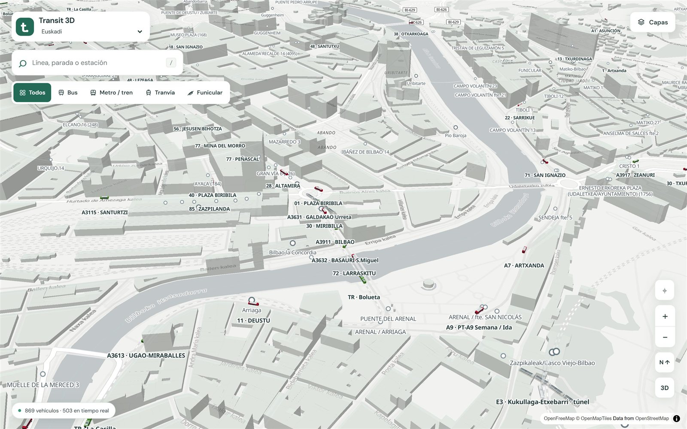
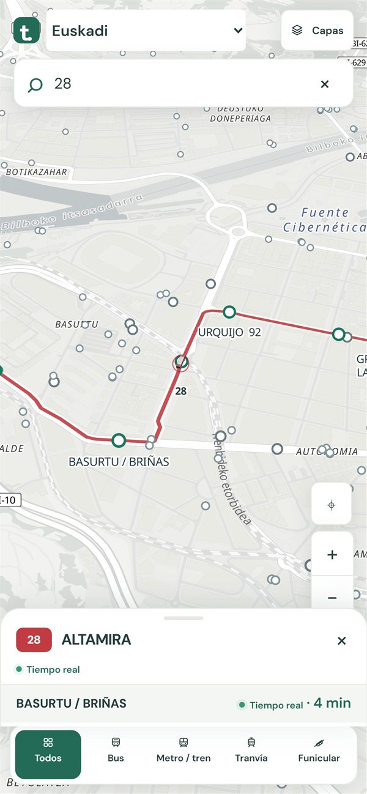
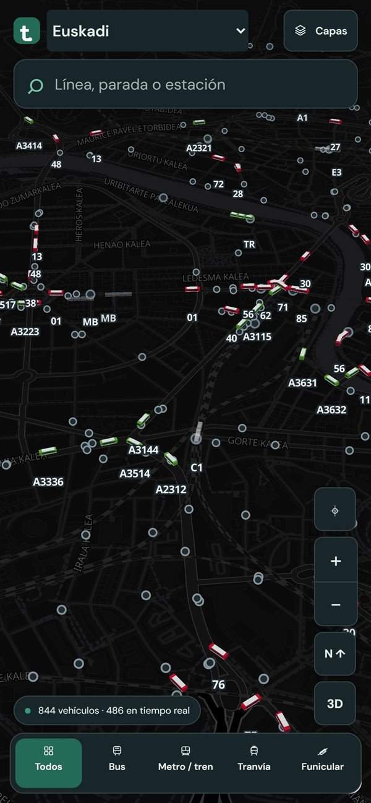

# Transit 3D

**El transporte público de Euskadi, moviéndose en directo sobre un mapa 3D.**

Autobuses, metro, trenes, tranvías y funiculares de Bilbao, Bizkaia, Gipuzkoa y Álava,
dibujados donde están ahora mismo. En hora punta hay más de 850 vehículos en el mapa a la
vez, casi la mitad con su posición en tiempo real.



## Qué puedes hacer

- **Ver la ciudad en movimiento.** Cada vehículo se dibuja con su librea real (Bilbobus
  rojo, Bizkaibus verde, Metro Bilbao gris y naranja, Euskotren blanco y azul, tranvía
  verde, Renfe blanco y rojo) y con su número real de coches: un metro de cuatro o cinco
  coches, un tranvía de tres o cinco módulos.
- **Tocar cualquier vehículo** para saber a dónde va, cuál es su próxima parada, cuánto
  le falta y de dónde sale su posición.
- **Buscar una línea, una parada o una estación** y ver su recorrido, los vehículos que
  la están haciendo y las próximas salidas.
- **Filtrar** por bus, metro y tren, tranvía o funicular, y activar o quitar operadores.
- **Explorar en 3D**, con los edificios y el metro y los trenes bajo tierra en los túneles.
- **Llevarla en el móvil**: el mapa ocupa la pantalla y la ficha del vehículo es una
  tarjeta que se despliega deslizando. Se puede instalar como aplicación (PWA).

| Una línea entera, con sus trenes | Un vehículo, con su próxima parada |
|---|---|
|  |  |

| Bilbao, todo el transporte a la vez | Abando en 3D: metro, tranvía, Renfe y buses |
|---|---|
|  |  |

<p align="center">
  
  &nbsp;&nbsp;
  
</p>

## ¿Es fiable lo que veo?

Cada vehículo y cada hora de llegada llevan una etiqueta sencilla:

- **Tiempo real:** el operador está dando la posición del vehículo (GPS) o su hora de
  llegada ahora mismo.
- **Aproximado:** hay datos actuales, pero la posición se estima entre una lectura y la
  siguiente.
- **Horario:** no hay datos en directo para ese servicio y se muestra según el horario.

Los operadores publican sus datos con algo de retraso: el GPS de un Bilbobus llega cada 20 s
y el de un Bizkaibus cada minuto, ya con uno o dos minutos de antigüedad. Entre lectura y
lectura la app predice el movimiento con la velocidad real a la que va cada vehículo, y
cuando el operador da a un autobús por «Llegando» a una parada, el mapa lo dibuja junto a
ella. Las mediciones de precisión están en [docs/bus-accuracy.md](docs/bus-accuracy.md).

## Qué transporte incluye

| | Operadores | Datos en directo |
|---|---|---|
| **Bizkaia** | Bizkaibus, Bilbobus | GPS de cada autobús y tiempos de paso oficiales |
| | Metro Bilbao | Llegadas previstas de cada tren, con su unidad |
| | Euskotren (tren, L3 y tranvías de Bilbao y Vitoria) | Llegadas previstas cuando el operador las publica |
| | Renfe Cercanías | GPS de cada tren |
| | Funicular de Artxanda, Puente Colgante y autobuses municipales | Horario |
| **Gipuzkoa** | Dbus (Donostia) | GPS de cada autobús |
| | Lurraldebus y autobuses municipales | Horario |
| **Álava** | Tuvisa (Vitoria-Gasteiz) | GPS de cada autobús |
| | Alavabus, La Unión | Horario |

En total son 34 fuentes de datos abiertos (Moveuskadi, Diputación de Bizkaia, Ayuntamiento
de Bilbao, Renfe…). Hay además paquetes de ciudad para Madrid, Málaga, Pamplona y València
en [city-packages](city-packages); se eligen con el selector de ciudad. Fuentes, protocolos y
limitaciones: [docs/data-sources.md](docs/data-sources.md).

## Para desarrolladores

### Ponerla en marcha

```bash
npm install
npm run dev
```

Abre http://localhost:5173. La primera vez tarda uno o dos minutos en descargar los horarios
de todos los operadores; después quedan en `server/cache`. La API corre en el puerto 3001 y
Vite le pasa las peticiones. Para probar en el móvil dentro de la misma wifi, `npx vite --host`
muestra la dirección de red (la instalación como aplicación necesita HTTPS).

Versión compilada, como en producción:

```bash
npm run build
npm start
```

Abre http://localhost:3001. No hace falta ninguna clave: todas las fuentes son abiertas.
El repositorio incluye `railway.toml` para desplegar; conviene montar un volumen en
`/app/server/cache`.

### Comprobaciones

```bash
npm test             # pruebas del servidor y del navegador, sin red
npm run typecheck    # tipos
npm run build        # tipos y compilación
```

Herramientas que trabajan con datos en vivo (con la app en marcha):

- `npm run audit:euskadi-realtime`: estado y antigüedad de cada fuente de Euskadi.
- `node --use-system-ca --import tsx server/monitor-bus-accuracy.ts 25 salida.jsonl`:
  distancia entre los autobuses dibujados y su GPS real.
- `node --use-system-ca --import tsx server/monitor-arriving.ts 10`: comprueba que un
  autobús «Llegando» se dibuja junto a su parada.
- `node --import tsx server/capture-screenshots.ts`: regenera las capturas de este README.
- `/admin` es la consola de administración (catálogos, fuentes, reparto entre GPS y horario)
  y `/debug` el inspector de posiciones de un vehículo.

### Cómo funciona

Cada operador tiene un adaptador que descarga sus horarios (GTFS) y sus datos en directo
(GTFS-RT, SIRI o JSON) y los traduce a un modelo común. El servidor decide para cada vehículo
dónde está y por dónde va a pasar, y el navegador lo anima con MapLibre y Three.js. Algunas
formas de línea publicadas están mal dibujadas y se corrigen con datos de OpenStreetMap
([docs/shape-repairs.md](docs/shape-repairs.md)).

Más detalle: [notas técnicas](docs/technical-overview.md), [arquitectura](docs/architecture.md),
[motor de movimiento](docs/motion-engine.md), [paquetes de ciudad](docs/city-packages.md),
[consola de administración](docs/admin-console.md) y [rendimiento](docs/performance.md).

Datos de mapa © colaboradores de [OpenStreetMap](https://www.openstreetmap.org/copyright),
teselas de [OpenFreeMap](https://openfreemap.org).
